# Welcome to my GitHub!

## About Me:

Hi, I'm Chris, I started coding at 18 with one goal, not just to learn how to code, but to turn my ideas into real applications people could use. That's still how I work. I'm a full-stack engineer in Thessaloniki, working mainly with React, Next.js, Node.js and Laravel.

## Useful Links:

&emsp;&emsp;&emsp;&emsp;&emsp;&emsp;

## Main Stack:

## Experience With:

